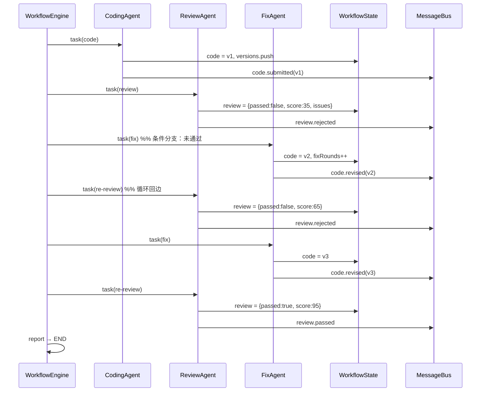

# 设计文档 · Code Review Workflow MVP

> 对应作业：Homework 2「Simple Workflow MVP（2 Weeks）」
> 目标：用最小可运行实现，讲清 Workflow 编排、Agent 通信、状态管理三件核心事。

---

## 1. 目标与约束

### 1.1 需求拆解

| 需求 | 设计落点 |
| --- | --- |
| 2–3 个 Agent 协作 | CodingAgent / ReviewAgent / FixAgent 三个角色，职责单一、边界清晰 |
| Agent 间消息传递 | `MessageBus` + 明确的 message type 协议 |
| 状态共享 | 单一 `WorkflowState`，由引擎注入每个 Agent 的 `ctx` |
| 顺序执行 | 节点 `next` 推进 |
| MVP 可运行 | Node.js 原生模块实现，零第三方依赖，离线可跑 |
| 推荐能力 | 条件分支、循环、并行、日志追踪、错误恢复、可视化 |

### 1.2 关键约束

1. **可复现**：演示不能依赖外网、API Key 或随机性 → 审查判定使用确定性规则引擎，LLM 设为可选增强。
2. **可观测**：作业评分 40% 在「流程完整性」，必须能直观看到每一步发生了什么 → 事件流 + 落盘 + Web 实时面板。
3. **可扩展**：评分 20% 在「可扩展性」→ 新增 Agent、改流程不应改引擎。

---

## 2. 总体架构

```text
┌────────────────────────────────────────────────────────────────┐
│                          CLI / Web UI                          │
│            实时事件（stdout / SSE） · 历史运行（run.json）        │
└───────────────────────────────┬────────────────────────────────┘
                                │ onEvent
┌───────────────────────────────▼────────────────────────────────┐
│                       WorkflowEngine                           │
│  节点调度 · 条件路由 · 循环上界 · 并行分支 · 重试 · 事件发射     │
└───────┬───────────────────┬───────────────────┬────────────────┘
        │ ctx.state         │ bus.send          │ ctx.llm
┌───────▼──────┐    ┌───────▼───────┐   ┌───────▼────────┐
│WorkflowState │    │  MessageBus   │   │ LLM Adapter     │
│ 代码/版本/    │    │ 结构化消息 +   │   │ mock / openai  │
│ 审查/轮次     │    │ 历史记录       │   │                │
└───────▲──────┘    └───────▲───────┘   └───────▲────────┘
        │                   │                   │
   ┌────┴─────┐        ┌────┴─────┐        ┌────┴─────┐
   │CodingAgent│        │ReviewAgent│       │ FixAgent │
   └───────────┘        └───────────┘       └──────────┘
                              │
                     ┌────────▼────────┐
                     │  Rule Engine    │
                     │ 行级规则 + 自动修复│
                     └─────────────────┘
```

设计原则：

- **引擎与业务解耦**：引擎只认识「节点 / 边 / 条件」，不认识「代码审查」。把 `code-review` 换成别的流程，引擎代码零改动。
- **Agent 与 LLM 解耦**：Agent 的核心逻辑是确定性的（规则、模板），LLM 只是可替换的能力插件。
- **单一状态源**：不允许 Agent 之间私自传递可变对象，所有跨步骤数据都经过 `state` 或 `bus`。

---

## 3. Agent 设计

### 3.1 角色划分

| Agent | 职责 | 不做什么 |
| --- | --- | --- |
| `CodingAgent` | 生成初始代码 / 接收外部代码，登记版本 | 不判断代码好坏 |
| `ReviewAgent` | 扫描问题、评分、判定是否通过、发消息给下游 | 不修改代码 |
| `FixAgent` | 按严重级别修复并产出新版本 | 不决定是否通过 |

职责分离带来一个直接好处：审查标准只存在于 `ReviewAgent`（及规则表），修复策略只存在于 `FixAgent`，二者可以独立替换。

### 3.2 Agent 契约

```js
class BaseAgent {
  async process(ctx, envelope) { return this.handle(ctx, envelope) }
  async handle(ctx, envelope) { /* 子类实现 */ }
  sendMessage({ to, type, payload, round }) { /* 走 MessageBus */ }
}
```

- `ctx`：`{ state, bus, llm, engine, injectFault }`，由引擎构造，保证 Agent 拿到的是同一个状态实例。
- `envelope`：`{ from, to, type, payload, round }`，是「投递到该 Agent 的任务消息」。
- 返回值：节点输出，写入 `state.outputs[nodeId]`，同时进入 `node.end` 事件。

### 3.3 修复策略为什么分级

`FixAgent` 每次只修复**一个严重级别**（有 high 修 high，否则修 medium，low 不自动改）：

- 让「循环」成为真实需求，而不是摆设：缺陷样例需要 2 轮修复 + 3 轮审查才通过；
- 符合真实工程习惯：先止血（正确性），再优化（可维护性），风格问题留人工；
- 便于演示与评分：轮次、得分、问题数量都能看到变化。

---

## 4. 状态与消息设计

### 4.1 WorkflowState

```js
{
  status: 'running' | 'completed' | 'failed',
  input: { requirement, language, code },   // 外部输入
  code: string,                              // 当前代码
  versions: [{ version, author, note, code }],// 版本历史（代码审查的关键证据）
  review: { round, passed, score, blocking, issues[], metrics },
  reviewRound: number,                       // ReviewAgent 执行次数
  fixRounds: number,                         // FixAgent 执行次数（循环上界依据）
  maxRounds: number,                         // 用户可配置 1–5
  outputs: { [nodeId]: any },                // 每节点输出
  result: { passed, finalScore, summary, ... } // 汇总结果
}
```

`issues[]` 元素：`{ id, ruleId, severity, line, snippet, title, message, suggestion, fixable }`。行号是自动修复与 UI 高亮的基础。

### 4.2 消息协议

```js
{
  id: 'msg-003', from, to, type, round,
  payload: { ... }, correlationId, timestamp
}
```

| type | 语义 | 关键字段 |
| --- | --- | --- |
| `code.submitted` | 编码完成，交给审查 | `version, source, lines` |
| `review.rejected` | 审查未通过，交给修复 | `score, blocking, issues[]` |
| `review.passed` | 审查通过，交给汇总 | `score, issues[]` |
| `code.revised` | 修复完成，回到审查 | `version, targetSeverity, fixed[]` |
| `code.unchanged` | 无可修项（防死循环） | `reason` |
| `review.parallel` | 并行审查分支上报 | `mode, score, issues[]` |

消息与状态的分工：状态保存「当前事实」，消息保存「协作过程」。UI 用消息流讲过程，用状态展示结果；日志同时保存两者，便于复盘。

---

## 5. 引擎设计

### 5.1 节点模型

```js
node = {
  type: 'agent' | 'function' | 'parallel',
  label,
  agent?,                 // agent 节点：Agent 注册名
  run?,                   // function 节点：纯函数
  branches?,              // parallel 节点：并发分支
  next: string | (ctx) => string,   // 顺序 / 条件路由
  routeLabel?: (ctx) => string,     // 路由原因（写日志与 UI）
  retry?: { attempts: n },
  onError?: 'end' | 'continue',
  maxVisits?, overflow?  // 循环兜底
}
```

### 5.2 执行算法（简化）

```text
current = workflow.entry
while current != END and hops < 100:
    node = workflow.nodes[current]
    if node.maxVisits and visits[current] >= node.maxVisits:
        current = node.overflow or END; continue
    visits[current] += 1

    emit node.start
    result = executeWithRetry(node)       # attempts 次，指数退避 150ms*n
    emit node.end + state.update

    if not result.ok and node.onError == 'end':
        status = failed; break

    nextId = resolve(node.next, ctx)      # 字符串或函数
    emit route(from=current, to=nextId, reason)
    current = nextId

status = completed
emit run.end(result, state)
```

### 5.3 终止性保证（三层）

1. **业务层**：`fixRounds >= maxRounds` → 路由到 `report`，必然结束；
2. **节点层**：`review.maxVisits = 6`、`fix.maxVisits = 5`，超限走 `overflow`；
3. **引擎层**：总跳数上限 100，超出直接 `run.error`。

三层是冗余的，但 MVP 演示更需要「不会卡死」而不是「恰好够用」。

### 5.4 并行执行

`parallel` 节点对每个分支构造 envelope 并 `Promise.all` 并发执行，分支失败被捕获为 `{ ok:false, error }`，不阻断其他分支。并行分支的 Reviewer 使用 `persist: false` 独立实例，避免两个分支同时改写 `state.review`；结果由 `merge` 节点统一写入。

---

## 6. 审查规则引擎

规则表结构：

```js
{
  id, severity, title,
  test: (line) => boolean,
  message, suggestion,
  fixLine: (line) => string | null    // null 表示只报告不自动修
}
```

当前规则：

| 规则 | 级别 | 检测 | 自动修复 |
| --- | --- | --- | --- |
| `OFF_BY_ONE` | high | `for (... <= x.length ...)` | `<=` → `<` |
| `LOOSE_EQUAL` | medium | `==` / `!=` | `==` → `===`，`!=` → `!==` |
| `VAR_USAGE` | medium | `var` 声明 | `var` → `let` |
| `CONSOLE_LOG` | low | `console.log/debug` | 不自动修（交人工） |

评分：`score = 100 - Σ(high 30 / medium 15 / low 5)`，最低 0；**存在 high 或 medium 即判不通过**。

为什么不直接让 LLM 当审查员：MVP 需要确定性、可复现、无网络；行级正则还能天然给出可修复的行号，便于演示自动修复。

### 6.1 扩展：安全规则

在上述 4 条质量规则之外，追加 3 条安全规则（`tag: 'security'`），且 `fixLine: null`：

| 规则 | 级别 | 检测 | 为什么不能自动修 |
| --- | --- | --- | --- |
| `EVAL_USAGE` | high | `eval(...)` | 正确改法依赖业务语义（解析 JSON？白名单求值？），不是字符串替换 |
| `HARDCODED_SECRET` | high | token / password 赋值 | 需要迁移到环境变量或密钥管理，涉及部署配置 |
| `INNER_HTML` | medium | `.innerHTML =` | 需要判断内容来源与转义策略，改错会破坏功能 |

这条设计让「转人工」分支不再是伪代码：`vulnerable-auth-service.js` 经过 2 轮修复后仍剩 3 个阻塞问题，路由到「达到上限，转人工」，最终判定未通过。同时 `ReviewAgent` 在每轮输出 `metrics`，报告里可对比代码规模变化。

### 6.2 扩展：代码度量

`metricsOf(code)` 统计总行数、有效代码行、注释行、最长行、函数与分支数量，作为审查报告的补充信息（不参与评分）。

---

## 7. 运行日志与可观测性

```text
runs/<runId>/
├── events.jsonl   # 逐条事件（实时写入）
└── run.json       # 全量记录：workflow / agents / input / events / messages / state / nodeRuns / result
```

事件类型：`run.init`、`run.start`、`node.start`、`node.end`、`node.retry`、`node.overflow`、`node.error`、`route`、`message`、`branch.start/end`、`state.update`、`run.end`、`run.error`。

同一份事件流同时服务三种消费方：

| 消费方 | 用途 |
| --- | --- |
| CLI | 人读的执行过程与问题表 |
| SSE / Web | 实时节点高亮、消息流、代码版本、问题列表 |
| 文件日志 | 复盘、排障、作为提交物证据 |

---

## 8. 错误处理与恢复

| 机制 | 位置 | 表现 |
| --- | --- | --- |
| 节点重试 | `retry.attempts` | `demo:fault` 中 reviewer 首次超时，第二次成功，流程继续 |
| 错误策略 | `onError` | 默认 `end`：标记失败并保留已产生的状态；可配 `continue` |
| 分支隔离 | parallel | 单分支失败记录 error，不影响另一分支与汇总 |
| 循环保护 | 三层终止 | 见 5.3 |
| 日志失败 | `RunStore.appendEvent` | 捕获异常，不影响主流程 |
| LLM 失败 | Agent 内部 | 回退模板文本，流程不中断 |

---

## 9. 可扩展性

### 9.1 新增一个 Agent（3 步）

1. 继承 `BaseAgent`，实现 `handle(ctx, envelope)`；
2. 在 `src/run.js` 的 `buildAgents()` 注册实例；
3. 在工作流 `nodes` 里加一个 `type:'agent'` 节点，并改相邻节点的 `next`。

### 9.2 新增一条流程

在 `src/workflows/` 新建定义文件、在 `workflows/index.js` 注册即可，引擎与 CLI/UI 自动支持。

### 9.3 拓扑演进

- 加「人工审批节点」：`type:'function'`，返回 `{ approved }`，路由到 fix 或 report；
- 加「测试 Agent」：在 fix 后插入 tests 节点，失败则回 loop；
- 并发规模扩大：parallel 分支改为读取同一输入，merge 负责冲突策略。

---

## 10. 关键设计取舍

| 取舍 | 选择 | 原因 |
| --- | --- | --- |
| 规则引擎 vs 纯 LLM 审查 | 规则为主，LLM 可选 | 可复现、离线、行号/自动修复可控 |
| 状态共享 vs 纯消息传递 | 两者都有 | 消息表达过程，状态表达事实，UI 与恢复都需要 |
| 单文件引擎 vs 引入工作流框架 | 自研轻量引擎 | 作业目标是理解编排；依赖越少越好，代码可读性优先 |
| 自动修复范围 | 仅 high / medium，逐级修复 | 让循环真实存在，且避免低风险改动 |
| Web 技术栈 | 原生 HTML/CSS/JS + SSE | 零构建、零依赖，打开即用 |

---

## 11. 时序图



---

## 12. 扩展能力设计（超出作业要求）

作业要求的是「能跑通的 MVP」，扩展部分解决的是「跑通之后如何被评审、被复盘」。

### 12.1 行级 Diff（`src/core/diff.js`）

- **算法**：经典 LCS 动态规划，按行切分，回溯得到 `equal / add / remove` 序列；输出 `diffStats` 统计与 `toUnifiedDiff` 统一格式文本。
- **复用**：同一实现服务三处 —— CLI `--diff`、Web 版本对比（`/api/runs/:id/diff`）、Markdown 报告第 4 节。
- **取舍**：LCS 是 O(n·m) 空间，但审查对象是几十行的示例代码，完全够用；换成 Myers 算法会牺牲可读性。

### 12.2 Markdown 报告（`src/report.js`）

- `buildReport(record)` 是**纯函数**：输入 `run.json` 全量记录，输出 Markdown 字符串，便于单元测试与二次加工。
- 报告章节与数据来源一一对应：结论 ← `result`；轮次轨迹 ← `node.end` 事件；遗留问题 ← `result.remainingIssues`；差异 ← `versions[0]` 与最终版本；消息链路 ← `messages`；度量 ← `state.review.metrics`。
- 只做「读日志 → 生成文档」，不引入模板引擎：报告是交付物，不是渲染系统。

### 12.3 运行统计（`src/analytics.js`）

- `summarize(records)` 也是纯函数：输入全部 `run.json`，输出通过率、平均得分/轮次/耗时、规则命中排行、最近运行列表。
- 规则命中从每轮 `node.end` 的 `issues` 反推，因此**不需要新增存储结构**，历史数据自动可用。

### 12.4 Web 历史回放与深链

- 新增 `replay(record)`：把 `events.jsonl` 里的事件依次喂给与实时流**完全相同**的渲染函数（日志、消息、状态、节点状态）。
- 这样「实时运行」与「历史回放」共享一套 UI 逻辑，避免了两套渲染代码逐渐不一致。
- 深链 `?run=<id>&tab=<tab>` 直接定位某次运行与标签页，便于视频录制、复现问题、提交证据。

### 12.5 单元测试（`test/`）

- 使用 Node 内置 `node:test` + `assert/strict`，零依赖，`npm test` 即跑。
- 三类覆盖：规则引擎（识别/评分/分级修复收敛/安全规则不可修）、工作流集成（默认缺陷、正确代码、安全样例转人工、故障重试、并行双审）、Diff 算法。
- 集成测试直接调用 `runWorkflow({ save: false })`，不污染 `runs/`。

### 12.6 演示视频

不依赖录屏软件，采用「真实内容 + 可重建」的流水线：

1. 实际执行 `node src/cli.js run --diff`，抓取终端输出（保留真实 runId 与轮次）；
2. 启动本地服务，用 Edge headless 截取真实 Web 界面（深链回放）；
3. 把终端文本与界面截图渲染进 7 张 1440×900 场景；
4. ffmpeg 逐段淡入淡出并拼接为 MP4。

好处：视频内容与代码状态严格一致，且流水线可重跑（不依赖人工剪辑）。

---

## 13. 后续演进

1. 用 AST / ESLint 替代行级正则，降低误报；
2. 引入人工审批节点与「驳回理由」回填；
3. 把规则、修复策略外置为配置文件（当前写在代码里）；
4. 持久化到 SQLite，支持多用户与并发任务；
5. 接入真实 LLM 做代码生成与审查解释，规则引擎作为兜底。
