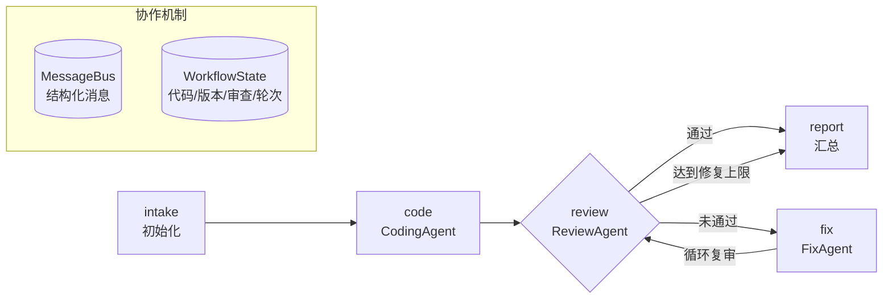

# Code Review Workflow · 多 Agent 协作 MVP

> Homework 2 —— 用一套轻量 Workflow 引擎，串联 **CodingAgent → ReviewAgent → FixAgent**，实现「编码 → 审查 → 修复 → 复审」的完整闭环。

项目零第三方运行时依赖（仅需 Node.js ≥ 18），默认离线 `mock` 模式即可完整演示，也可切换到任意 OpenAI 兼容模型。

---

## 1. 与作业要求的对应关系

| 作业要求 | 本项目实现 |
| --- | --- |
| 至少 2 个 Agent 协作完成完整流程 | 3 个 Agent：`CodingAgent` / `ReviewAgent` / `FixAgent`，覆盖生成、审查、修复全链路 |
| Agent 间消息传递 | `MessageBus` 结构化消息（`code.submitted`、`review.rejected`、`code.revised` 等），全部落盘可回放 |
| 状态共享 | 所有 Agent 读写同一个 `WorkflowState`（代码、版本、审查结果、轮次、结果） |
| 顺序执行 | 引擎按节点 `next` 顺序推进（intake → code → review → …） |
| 条件分支（推荐） | 审查通过 → `report`；未通过 → `fix` |
| 循环（推荐） | `fix → review` 回边，配合 `fixRounds / maxRounds` 上界与 `maxVisits` 兜底 |
| 并行（推荐） | 引擎支持 `parallel` 节点，`npm run demo:parallel` 演示双路审查并发 |
| 执行日志与状态追踪（推荐） | 事件流 + `runs/<runId>/events.jsonl` + `run.json`，CLI 实时打印、Web 实时可视化 |
| 错误处理与恢复（推荐） | 节点级 `retry.attempts` 重试、`onError` 策略、循环上限与跳数保护 |
| 可视化编排界面（可选） | `npm run ui` 打开本地实时面板：节点状态、消息流、问题列表、代码版本、历史回放 |
| 文档 | 本 README + [DESIGN.md](./DESIGN.md)（流程图 / 架构说明 / 使用文档） |

### 超出作业要求的扩展（详见第 7 节）

| 扩展 | 说明 |
| --- | --- |
| 安全审查规则 | 新增 `eval` / `innerHTML` / 硬编码凭据三条规则，且**不可自动修复**，用于演示「达到上限转人工」 |
| 行级 Diff | LCS 算法对比任意两个代码版本：CLI `--diff`、Web「对比 v1 → 当前版本」 |
| Markdown 报告导出 | `npm run report` 生成包含轮次轨迹、遗留问题、代码差异、消息链路的评审报告 |
| 运行统计 | `npm run stats` 汇总通过率、平均轮次、高分频规则、最近运行 |
| 历史回放与深链 | Web 侧自动加载历史运行，支持 `?run=<id>&tab=<tab>` 回放与分享 |
| 单元测试 | 13 项 `node:test` 用例，覆盖规则引擎、工作流集成、Diff 算法 |
| 演示视频 | `演示视频.mp4`（47 秒，真实 CLI 输出 + 真实界面截图合成） |

---

## 2. 快速开始

环境：Node.js ≥ 18（无需 `npm install`，无第三方依赖）。

```bash
# 0) 进入项目目录
cd code-review-workflow

# 1) 默认演示：CodingAgent 生成含缺陷代码 → 审查 → 修复 → 复审通过
node src/cli.js run --print-code
# 或 npm run demo

# 2) 审查内置的缺陷样例
npm run demo:buggy

# 3) 审查一份已经正确的代码（一次通过）
npm run demo:clean

# 4) 演示错误恢复：inject 一次审查服务故障，由引擎自动重试
npm run demo:fault

# 5) 演示并行编排：逻辑审查 + 风格审查并发执行
npm run demo:parallel

# 6) 演示安全审查：不可自动修复的问题达到上限后转人工
npm run demo:security

# 7) 启动可视化界面（实时查看节点、消息、问题与代码版本）
npm run ui          # http://localhost:3000

# 8) 查看差异 / 导出报告 / 查看统计 / 跑单元测试
npm run demo:diff
npm run report
npm run stats
npm test
```

自定义运行：

```bash
node src/cli.js run -r "实现订单金额校验函数" --max-rounds 2 --print-code --diff
node src/cli.js run -c path/to/your-code.js --print-code
node src/cli.js runs           # 查看历史运行记录
node src/cli.js report <runId> # 导出指定运行的 Markdown 报告
```

CLI 参数：

| 参数 | 说明 |
| --- | --- |
| `-r, --requirement <文本>` | 需求描述，留空使用内置示例需求 |
| `-c, --code <文件>` | 直接审查外部代码文件；不填则由 CodingAgent 生成 |
| `--max-rounds <n>` | 最大修复轮次（1–5，默认 3） |
| `--llm <mock\|openai>` | LLM 模式，默认 `mock`（离线可运行） |
| `-w, --workflow <名称>` | `code-review`（默认）或 `parallel-demo` |
| `--fault-inject <agent>` | 注入一次故障演示重试（如 `reviewer`） |
| `--diff` | 运行结束后打印 v1 → 最终版本的行级差异 |
| `--no-save` | 不写入 `runs/` 日志 |
| `--print-code` | 结束时打印最终代码 |

命令一览：

| 命令 | 说明 |
| --- | --- |
| `node src/cli.js run [选项]` | 运行工作流 |
| `node src/cli.js runs` | 查看历史运行 |
| `node src/cli.js report [runId]` | 导出 Markdown 审查报告到 `reports/` |
| `node src/cli.js stats` | 查看历史运行统计 |
| `node src/cli.js ui` | 启动 Web 可视化界面 |

---

## 3. 运行效果（真实输出节选）

```text
▶ code 编码 Agent · 第 1 次执行
  ⇢ coder → reviewer  code.submitted     v1 · CodingAgent 生成 · 19 行
  ✔ 生成 v1 代码（19 行，自动生成） (2ms)
  ↳ 路由 code → review

▶ review 审查 Agent · 第 1 次执行
  ⇢ reviewer → fixer  review.rejected    得分 35 · 4 个问题未通过
  ✔ 未通过 · 得分 35 · 问题 4 个（high 1 / medium 2 / low 1） (1ms)

   行号  级别   规则                  说明
      6  high    OFF_BY_ONE          循环边界可能越界
      6  medium  VAR_USAGE           使用了 var 声明
      7  medium  LOOSE_EQUAL         使用了宽松相等比较
     15  low     CONSOLE_LOG         代码中直接输出调试日志
  ↳ 路由 review → fix（未通过 · 进入修复）

▶ fix 修复 Agent · 第 1 次执行
  ⇢ fixer → reviewer  code.revised       v2 · 修复 1 个 high 问题
  ✔ 修复 1 个 high 问题 → v2：循环边界可能越界 (0ms)
  ↳ 路由 fix → review（循环回到审查 · 第 2 轮）
...
════════════════ Workflow 完成 ════════════════
状态      完成
判定      通过
得分      95
审查/修复 3 轮 / 2 轮
最终版本  v3（共 3 个版本）
```

设计上 FixAgent **每次只处理一个严重级别**（先 high，再 medium），因此真实产生多轮「审查 → 修复」循环，而不是一轮就结束；`low` 风格建议不阻塞通过，留给人工决策。

---

## 4. 目录结构

```text
code-review-workflow/
├── package.json
├── README.md
├── DESIGN.md
├── src/
│   ├── cli.js                     # 命令行入口（run / runs / report / stats / ui）
│   ├── server.js                  # 本地 Web 服务 + SSE 事件推送
│   ├── run.js                     # 运行编排：组装 Agent / 引擎 / 日志
│   ├── report.js                  # 扩展：Markdown 审查报告生成
│   ├── analytics.js               # 扩展：运行历史统计
│   ├── core/
│   │   ├── engine.js              # Workflow 引擎（顺序/分支/循环/并行/重试）
│   │   ├── agent.js               # Agent 基类
│   │   ├── message-bus.js         # 消息总线
│   │   ├── state.js               # 共享状态模型
│   │   ├── logger.js              # 运行日志存储（runs/）
│   │   └── diff.js                # 扩展：LCS 行级 Diff
│   ├── agents/
│   │   ├── coder-agent.js         # CodingAgent
│   │   ├── reviewer-agent.js      # ReviewAgent
│   │   └── fixer-agent.js         # FixAgent
│   ├── rules/
│   │   └── review-rules.js        # 确定性审查规则 + 自动修复能力 + 代码度量
│   ├── workflows/
│   │   ├── code-review.js         # 主流程定义
│   │   └── parallel-demo.js       # 并行编排示例
│   ├── samples/                   # 缺陷样例 / 正确样例 / 安全风险样例
│   └── llm/
│       └── index.js               # mock / OpenAI 兼容适配层
├── test/                          # 扩展：node:test 单元测试
│   ├── rules.test.js
│   ├── workflow.test.js
│   └── diff.test.js
├── web/
│   ├── index.html
│   ├── style.css
│   └── app.js
├── reports/                       # 运行时生成（导出的 Markdown 报告）
└── runs/                          # 运行时生成（已 gitignore）
```

---

## 5. 架构与流程



```text
intake → code → review ─┬─(通过)──────────────→ report → END
                        ├─(未通过 & 未达上限)→ fix → review（循环）
                        └─(未通过 & 达上限)→ report
```

三个 Agent 的职责：

| Agent | 输入 | 输出 | 关键行为 |
| --- | --- | --- | --- |
| `CodingAgent` | 需求 / 外部代码 | v1 代码 | 生成初始实现或接收外部代码，写入版本历史 |
| `ReviewAgent` | 当前代码 | `{ passed, score, issues[] }` | 规则扫描出带行号的问题，按严重级别扣分并判定 |
| `FixAgent` | 问题列表 | 新版本代码 | 按严重级别分批自动修复，每次产出 vN+1 |

消息协议（全部记录在 `messages` 中）：

| type | from → to | 载荷 |
| --- | --- | --- |
| `code.submitted` | coder → reviewer | `{ version, source, lines }` |
| `review.rejected` | reviewer → fixer | `{ score, passed, blocking, issues[] }` |
| `review.passed` | reviewer → reporter | `{ score, passed, issues[] }` |
| `code.revised` | fixer → reviewer | `{ version, targetSeverity, fixed[] }` |
| `code.unchanged` | fixer → reviewer | `{ reason, version }` |
| `review.parallel` | 并行审查 Agent → engine | `{ mode, score, issues[] }`（并行示例） |

共享状态关键字段：`code`、`versions[]`、`review`、`reviewRound`、`fixRounds`、`maxRounds`、`outputs{}`、`result`。

---

## 6. 流程控制与容错

- **顺序执行**：节点声明 `next` 字符串即可。
- **条件分支**：`next` 写成函数，引擎把 `ctx`（含共享状态）传入，返回下一个节点 id。
- **循环**：`fix.next = 'review'` 形成回边；同时 `fixRounds >= maxRounds` 时路由到 `report`，节点还配置 `maxVisits` 作为兜底（防死循环），引擎另有 100 步总跳数上限。
- **并行**：`type: 'parallel'` 的节点用 `Promise.all` 并发执行多个 Agent 分支，结果在 `merge` 节点汇总。
- **错误重试**：节点配置 `retry: { attempts: 2 }`；失败后按 150ms×attempt 退避重试。`npm run demo:fault` 可复现。
- **错误策略**：`onError: 'end'`（默认，终止并标记失败）或 `'continue'`。
- **日志**：每个事件同时用于 CLI 实时输出、SSE 推送、`events.jsonl` 落盘；结束写 `run.json` 全量快照。

---

## 7. 可视化界面

```bash
npm run ui     # 默认 http://localhost:3000，可用 PORT=xxxx 修改
```

界面能力：

- 左侧：Workflow 节点卡片实时状态（等待 / 执行中 / 完成 / 失败）、执行次数、路由规则、运行历史；
- 右侧四个标签页：消息流、审查问题（严重级别 / 行号 / 修复建议）、代码版本（含命中行高亮 + 「对比 v1 → 当前版本」差异视图）、执行日志；
- 支持一键运行、选择代码来源（自动生成 / 缺陷样例 / 正确样例 / 安全风险样例）、设置最大轮次、注入故障观察重试；
- 顶部「导出报告」直接下载 Markdown 报告；点击历史运行可回放，并支持 `?run=<id>&tab=<messages|issues|code|logs>` 深链分享。

后端接口：`GET /api/workflows`、`GET /api/samples`、`GET /api/stats`、`POST /api/runs`、`GET /api/runs`、`GET /api/runs/:id`、`GET /api/runs/:id/diff`、`GET /api/runs/:id/report`、`GET /api/runs/:id/events`（SSE）。

---

## 8. 扩展能力（超出作业要求）

### 8.1 安全审查规则

在原有 4 条质量规则之外新增 3 条安全规则，且全部**不提供自动修复**，用于验证「Agent 修不了 → 达到上限 → 转人工」的真实分支：

| 规则 | 级别 | 检测内容 |
| --- | --- | --- |
| `EVAL_USAGE` | high | `eval(...)` 动态执行字符串（RCE 风险） |
| `HARDCODED_SECRET` | high | 疑似硬编码 token / password |
| `INNER_HTML` | medium | 直接赋值 `innerHTML`（XSS 风险） |

```bash
npm run demo:security   # 使用 src/samples/vulnerable-auth-service.js
```

结果：2 轮修复后仍有 3 个阻塞问题 → 路由到「转人工」，最终判定未通过（得分 25）。

### 8.2 行级 Diff

`src/core/diff.js` 用 LCS 计算行级差异，输出 `add / remove / equal` 三类行与统计：

```bash
npm run demo:diff                                  # CLI 打印 v1 → 最终版本差异
node src/cli.js run --diff --print-code
```

Web 端在「代码版本」页点「对比 v1 → 当前版本」即可看到红/绿差异行（走 `/api/runs/:id/diff`）。

### 8.3 Markdown 报告

```bash
npm run report            # 导出最近一次运行
node src/cli.js report <runId>
```

报告写入 `reports/<runId>.md`，包含：运行概要、审查/修复轮次轨迹、遗留问题、v1 → 最终版本 diff、Agent 消息链路、代码度量。

### 8.4 运行统计

```bash
npm run stats
```

统计维度：运行总数、通过/失败、通过率、平均得分、平均审查/修复轮次、平均耗时、消息总数、高频规则命中 TOP、最近运行。

### 8.5 单元测试

```bash
npm test      # node --test，13 个用例
```

覆盖：规则识别与评分、分级修复收敛、安全规则不可修复、代码度量、Diff 算法、工作流集成（默认/正确/安全/故障重试/并行）。

### 8.6 演示视频

`演示视频.mp4`（1440×900，约 47 秒）：真实 CLI 输出 + 真实 Web 界面截图 + 架构与扩展说明，含 7 个场景。

---

## 9. 可选：接入真实 LLM

默认 `mock` 模式不联网。若想用真实模型生成初始代码与最终摘要：

```bash
# PowerShell
$env:OPENAI_API_KEY="sk-..."
$env:OPENAI_BASE_URL="https://api.openai.com/v1"   # 也可换成任意兼容网关
$env:OPENAI_MODEL="gpt-4o-mini"
node src/cli.js run --llm openai --print-code
```

说明：审查判定仍由确定性规则引擎完成，保证流程可复现；LLM 仅用于「初始代码生成」和「结论摘要」两处，接口失败会回退到模板文本。未配置密钥时使用 `--llm openai` 会直接给出明确报错，不会静默失败。

---

## 10. 自检清单

- [x] 至少 2 个 Agent（本项目 3 个）协作跑通端到端流程
- [x] Agent 间消息传递 + 共享状态
- [x] 顺序执行、条件分支、循环、并行示例
- [x] 重试与错误恢复（可复现演示）
- [x] 执行日志、状态追踪、可视化界面
- [x] README / DESIGN 文档、流程图与架构说明
- [x] 零第三方依赖，离线可运行
- [x] 扩展：安全规则、行级 Diff、报告导出、运行统计、历史回放、13 项单元测试
- [x] 演示视频 `演示视频.mp4`

---

## 11. 限制与后续演进

- Mock 模式下代码生成为固定模板，不代表通用编码能力；真实场景应接入 LLM 与更完整的规则/测试执行。
- 规则引擎是启发式静态扫描（行级正则），不构建 AST，存在误报可能；后续可替换为 ESLint / tree-sitter。
- 当前循环上限为 3 轮（可调 1–5），复杂场景可改为「人工审批节点」。
- Web 界面为单机演示版，无鉴权与多用户隔离；生产化需要引入任务队列与持久化数据库。

---

## 12. 提交说明

提交物（按作业要求）：

1. 源代码仓库（GitHub / Gitee）打包；
2. `README.md` + `DESIGN.md`；
3. 演示视频 `演示视频.mp4`（47 秒，CLI 实录 + 真实界面 + 扩展能力）；
4. 备份压缩包命名为「学号姓名」，即 `2412190630谢逸轩.zip`，提交到课程「002Homework2」下。

> 压缩包请排除 `runs/` 与 `node_modules/`（项目已提供 `.gitignore`）。
